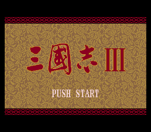
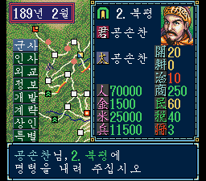
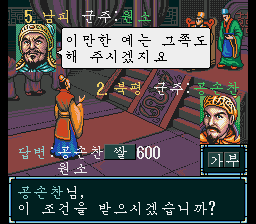
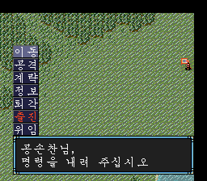
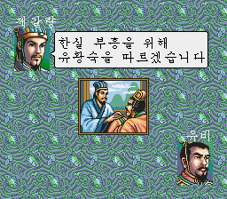
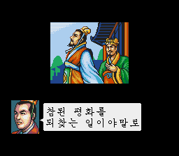

# 삼국지 III

- 게임명 : 삼국지 III (Sangokushi III)
- 제작자 : nayasis
- 플랫폼 : 메가 드라이브
- 장르 : 전략
- 패치
  - [Sangokushi III (T-ko) v1.0.xdelta](.attachment_readme.md/Sangokushi%20III%20%28T-ko%29%20v1.0.xdelta)
- 원본롬
  -  SHA-256: 46791222D6E61E7D6EEB600630770DBAD7626D3E9AA26BD1DB958B7C534D57D8
  - [메타정보](.attachment_readme.md/Sangokushi%20III.json)
- 사용 AI : OpenAI Codex (GPT-6 Sol, GPT-6 Astra, GPT-5.6 Terra)

